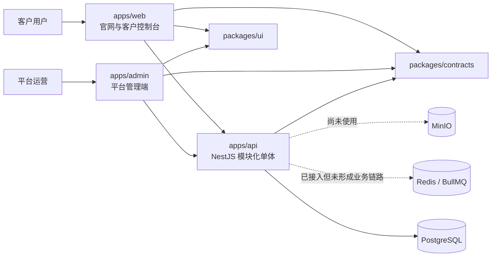
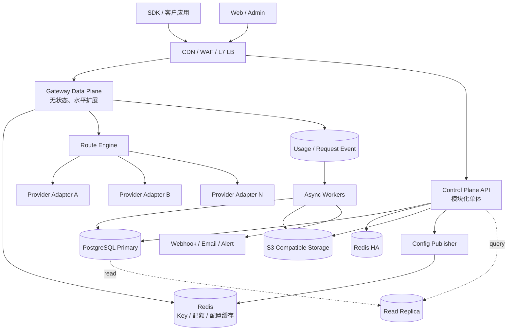

# Nexus AI Router 架构审计与演进方案

更新日期：2026-10-22  
适用范围：`apps/web`、`apps/admin`、`apps/api`、`packages/contracts`、`packages/ui` 与本地基础设施

## 1. 结论

当前项目已经具备清晰的产品原型和模块化单体基础：Turbo 单仓、Web/Admin/API 独立应用、共享契约、NestJS 模块、Controller → Service → Repository 分层、数据库迁移、JWT 会话、结构化日志、统一错误响应和初步租户数据隔离均已落地。

它目前适合内部联调、产品验证和小流量试运行，还不适合直接承载生产级多模型网关。主要原因是：

1. 现有 API 以控制台管理为主，尚未形成真实模型调用的数据面。
2. 账户 ID 暂时代替工作区，无法满足组织、项目、成员和多租户授权。
3. API Key 已能创建和撤销，但还没有进入请求鉴权、限流与配额链路。
4. 路由规则已有 CRUD，但没有配置缓存、版本发布、熔断和真实执行器。
5. 余额仍是演示值，没有不可变账本、预扣、结算和并发一致性保证。
6. Redis、BullMQ 和 MinIO 已加入依赖，但没有形成生产用途的 Worker、缓存和对象存储模块。
7. 缺少自动化测试、CI/CD、容器镜像、部署清单、指标、追踪和告警。

推荐演进方向是“模块化控制面 + 独立数据面 + 异步 Worker”。现阶段不建议将每个业务领域拆成微服务，也不建议立即引入多区域、全量事件溯源或复杂 Kubernetes 平台。

## 2. 当前架构



### 当前代码组织

| 层级 | 现状 | 评价 |
| --- | --- | --- |
| 单仓 | Turbo + npm workspaces | 方向正确，应用可独立运行 |
| 前端 | Web 与 Admin 独立 Vue/Vite 应用 | 权限和发布职责清晰 |
| 后端 | 单 NestJS 进程承载认证、目录、控制台、管理端 | 适合当前规模，后续需分离数据面 |
| 契约 | `packages/contracts/src/index.ts` 共享类型 | 避免字段漂移，但单文件会持续膨胀 |
| 数据 | PostgreSQL + TypeORM migration | 基础可靠，仍缺少工作区、账本和调用链模型 |
| 缓存/队列 | Redis 与 BullMQ 已配置 | 当前没有缓存接口、任务处理器和失败队列 |
| 对象存储 | MinIO 本地服务 | 尚未封装和消费 |
| 安全 | Helmet、CORS、JWT、HttpOnly refresh cookie、密码哈希 | 基础良好，缺少限流、MFA、密钥管理和实时会话校验 |
| 运维 | 健康检查、Pino 请求日志 | 缺少指标、追踪、依赖健康度、部署和告警 |

## 3. 当前架构的优点

### 3.1 保持模块化单体是正确选择

当前业务规模尚不足以支撑大量微服务的部署和治理成本。认证、模型目录、管理后台、工作区配置仍可以共享一个控制面数据库和发布单元。继续保持模块化单体，可以降低跨服务事务、接口版本、联调和运维复杂度。

### 3.2 已有较好的模块分层

后端使用 Controller、Service、Repository 分离协议、业务编排和数据访问；前端按页面领域维护 `api/types.ts`、`api/endpoints.ts`、`api/index.ts` 和私有 `cmp`。这些 seam 已经具备可继续深化的基础。

### 3.3 客户端和管理端物理隔离

普通客户控制台与平台管理后台是两个应用，避免了把平台能力通过路由判断混入客户应用。后续可以分别配置域名、CSP、部署频率、WAF 策略和访问网络。

### 3.4 认证基础比普通原型完整

项目已经具备短时 access token、哈希 refresh token、会话撤销、密码重置、登录锁定、OAuth state 校验、HttpOnly Cookie 和角色守卫，为后续安全加固提供了良好基础。

## 4. 关键风险与优先级

| 优先级 | 风险 | 当前表现 | 影响 |
| --- | --- | --- | --- |
| P0 | 无真实数据面 | 仅有 `/v1/models`，没有推理代理 | 产品无法形成真实调用闭环 |
| P0 | 租户模型不完整 | `userId` 暂代 workspaceId | 团队、项目、授权和账单无法正确扩展 |
| P0 | API Key 未用于鉴权 | 只支持创建、列表和撤销 | 无法安全开放模型调用接口 |
| P0 | 无配额与账本 | 余额和交易是演示数据 | 并发调用时可能超额、少扣或重复扣费 |
| P0 | 无流量治理 | 没有限流、并发限制、超时预算、熔断 | 上游故障会放大并拖垮网关 |
| P0 | 缺少测试和 CI | 仓库没有自动化测试与 CI 工作流 | 修改认证、计费和迁移时回归风险高 |
| P1 | 会话撤销非实时 | access token 仅验证签名，角色和状态最长缓存 15 分钟 | 封禁、改权和撤销不能立即生效 |
| P1 | refresh rotation 存在竞态 | 查找、撤销、签发未放在一个事务中 | 并发刷新可能生成多个有效会话 |
| P1 | 查询无法支撑大数据量 | `%ILIKE%`、offset 分页、日志单表 | 数据增长后出现慢查询和数据库抖动 |
| P1 | 单实例依赖 | PostgreSQL、Redis、MinIO 均是本地单实例 | 任一依赖失败都会中断服务 |
| P1 | 缺少可观测性 | 只有请求日志和 request id | 无法快速定位上游、队列、数据库瓶颈 |
| P1 | 配置无版本和缓存 | 路由规则直接查 PostgreSQL | 高并发时增加数据库压力，发布无法回滚 |
| P2 | 前端首包偏大 | Web 构建主包约 623 kB | 首次加载和弱网体验下降 |
| P2 | 契约和页面文件变浅 | contracts 单文件、console section 同时承载多个领域 | 改动范围扩大，维护成本增长 |

## 5. 目标架构

### 5.1 总体拓扑



### 5.2 部署单元

建议逐步形成以下部署单元：

| 部署单元 | 职责 | 扩展方式 |
| --- | --- | --- |
| `apps/web` | 官网、文档、客户控制台 | CDN 静态部署 |
| `apps/admin` | 平台运营后台 | 独立域名，CDN 或内网部署 |
| `apps/control-api` | 认证、工作区、模型、供应商、价格、账单查询、管理操作 | 无状态水平扩展 |
| `apps/gateway` | API Key 鉴权、配额、路由、上游调用、流式转发 | 按 RPS 和并发连接水平扩展 |
| `apps/worker` | 用量聚合、结算、通知、渠道探测、日志归档 | 按队列积压水平扩展 |

初期可以保留现有 `apps/api` 作为 Control Plane，在同仓新增 Gateway 和 Worker。只有当控制面领域出现独立扩展、故障隔离或团队归属需求时，再拆成独立服务。

## 6. 关键深模块与接口

高并发网关不应让 Controller 直接组合数据库、缓存、供应商 SDK 和计费逻辑。建议建立以下深模块，使复杂度集中在稳定 seam 后面。

### 6.1 Gateway Executor

```ts
interface ModelGateway {
  execute(request: GatewayRequest, context: RequestContext): AsyncIterable<GatewayEvent>
}
```

调用方只需了解统一请求、上下文和事件流。内部隐藏鉴权、配额预占、路由、超时、重试、流式背压、错误转换、日志和结算。

### 6.2 Route Engine

```ts
interface RouteEngine {
  plan(request: GatewayRequest, snapshot: PolicySnapshot): RoutePlan
}
```

`RoutePlan` 应是确定性结果，包含候选 deployment、优先级、超时预算、允许重试条件和降级方式。路由计算保持纯逻辑，方便做回放、灰度和属性测试。

### 6.3 Provider Adapter

```ts
interface ProviderAdapter {
  invoke(plan: ProviderCall, signal: AbortSignal): AsyncIterable<ProviderEvent>
}
```

只有当至少存在两个真实上游实现时再固化这个 seam。Adapter 负责供应商协议、鉴权、错误码和流式格式，不能处理客户计费或租户权限。

### 6.4 Usage Ledger

```ts
interface UsageLedger {
  reserve(command: ReserveCredit): Promise<Reservation>
  settle(command: SettleUsage): Promise<LedgerResult>
  release(command: ReleaseReservation): Promise<void>
}
```

调用链不能直接修改余额字段。余额必须来自不可变账本；预占、结算和释放使用幂等键及数据库事务。

### 6.5 Policy Snapshot

路由、模型、价格、配额和渠道状态应编译为带版本号的只读快照。Gateway 只读取内存/Redis 快照，不在每次模型请求中联表查询 PostgreSQL。

## 7. 高并发设计

### 7.1 区分 RPS 与长连接并发

LLM 流式请求可能持续数十秒。容量规划必须同时关注：

- 新建请求速率。
- 活跃 SSE/流连接数。
- 每连接上下行带宽。
- 上游首字延迟和总持续时间。
- Node.js event loop lag、内存和 socket 数。

建议第一阶段压测目标设为单区域 1,000 RPS、10,000 条并发流，再依据真实平均持续时间和模型类型调整。目标不是一次性达到该数字，而是先建立可重复的压测基线。

### 7.2 请求执行策略

1. Edge 完成连接限制、基础 DDoS 防护和请求体大小限制。
2. Gateway 使用 API Key 前缀快速定位、哈希校验和本地短缓存。
3. Redis 原子脚本完成租户 RPM、并发、Token/金额配额预占。
4. Route Engine 从版本化快照生成候选列表。
5. 每个候选 deployment 使用独立连接池、超时、并发舱壁和熔断器。
6. 只有在尚未返回首字节且请求可安全重试时才切换候选。
7. 客户断开连接时立即向上游发送 abort，避免继续产生费用。
8. 主响应路径只写轻量事件；日志聚合、结算和通知异步处理。

### 7.3 缓存层次

| 数据 | 缓存位置 | 建议 TTL/失效方式 |
| --- | --- | --- |
| API Key 元数据 | Gateway L1 + Redis L2 | 短 TTL；撤销时发布失效事件 |
| 路由/价格/模型快照 | Gateway 内存 + Redis | 版本发布驱动更新，TTL 兜底 |
| 模型目录与 facets | Redis / CDN | 30–300 秒 |
| 会话撤销版本 | Redis | 与 access token TTL 一致 |
| 控制台聚合指标 | Redis 或物化表 | 分钟级刷新 |

缓存必须有版本、命中率指标和数据库回源限速，避免 Redis 故障导致数据库雪崩。

### 7.4 数据库性能

- 为模型搜索引入 `pg_trgm` GIN 索引，避免 `%ILIKE%` 全表扫描。
- 管理列表和请求日志从 offset 分页迁移到 cursor/keyset 分页。
- `request_logs` 按时间和 workspace 分区，热数据保留在 PostgreSQL，冷数据归档对象存储。
- 用量聚合通过 Worker 写入小时/日粒度表，不在用户请求中扫描明细。
- 引入 PgBouncer transaction pooling，并设置连接池上限、statement timeout 和慢查询告警。
- 控制台只读查询可逐步切到只读副本，账本和配置写入始终走主库。

## 8. 安全架构

### 8.1 身份与租户

建立 `organizations`、`workspaces`、`projects`、`workspace_members`。用户角色分为平台角色与工作区角色：

- 平台角色：PlatformAdmin、Operations、Support、Auditor。
- 工作区角色：Owner、Admin、Developer、Billing、Viewer。

JWT 不应长期携带最终权限结论，只携带身份、会话和权限版本。关键操作通过 Redis/数据库校验账户状态和 membership version。数据库查询必须从服务端 `TenantContext` 注入 workspaceId，不能接受客户端自报租户 ID。

可在核心租户表启用 PostgreSQL RLS 作为纵深防御，但应用层显式租户条件仍需保留。

### 8.2 会话与登录

现有实现需要以下升级：

- refresh token 查找、撤销和新会话创建放入同一事务，并检测旧 token 重放。
- access token 增加 `sessionVersion`/`authVersion`，封禁、改密和改权时在 Redis 立即失效。
- 管理员启用 MFA/WebAuthn，敏感操作要求近期重新认证。
- 登录限流使用 Redis 按 IP、邮箱和设备组合计数，不能只依赖用户表字段。
- `trustProxy` 配置可信代理 CIDR，不能在未知部署环境中无条件信任全部转发头。
- OAuth 增加 PKCE、一次性 state、明确 redirect allowlist 和 provider subject 绑定，避免仅按邮箱合并身份。
- 生产环境关闭公开 Swagger，或放在鉴权后的内部域名。

### 8.3 API Key 和供应商密钥

- API Key 增加 projectId、scope、过期时间、CIDR、最近使用位置和创建人。
- 只保存高熵 secret 的哈希；比较使用稳定的固定时间路径。
- 供应商密钥使用 KMS envelope encryption，数据库只保存密文、key version 和审计信息。
- 解密权限只授予 Gateway，Control Plane 默认不能读取明文。
- 日志对 Authorization、Cookie、API Key、prompt、文件 URL 和个人数据进行结构化脱敏。

### 8.4 请求安全

- 全局请求大小、字段深度、multipart、压缩比和响应大小限制。
- 供应商 base URL 只能来自管理员批准的 allowlist，防止 SSRF。
- 设置 CSP、HSTS、Referrer-Policy 和精确 CORS allowlist。
- 依赖锁定镜像 digest，CI 生成 SBOM 并运行 SCA、secret scan、SAST 和容器扫描。
- 审计日志采用追加写、独立保留期和不可由普通管理员修改的存储策略。

## 9. 计费与一致性

### 9.1 数据模型

建议使用双分录或至少不可变流水模型：

- `accounts`：币种与账户状态。
- `ledger_entries`：不可变借贷流水、业务类型、幂等键、关联 requestId。
- `credit_reservations`：请求前预占，包含过期时间。
- `usage_records`：上游与客户 Token、单位价格版本、成本、售价和利润。
- `price_versions`：价格生效区间，不覆盖历史价格。

### 9.2 并发规则

- 每次模型调用使用全局唯一 requestId 和客户端可选 Idempotency-Key。
- 预占额度与请求创建在同一事务完成。
- 结算、失败释放可以重复执行，但同一幂等键只产生一次账本结果。
- 不以浮点数计算金额；数据库使用 numeric，应用使用 Decimal/整数最小货币单位。
- 流式调用按最终上游 usage 结算；缺失 usage 时采用供应商对应 tokenizer 估算并标记来源。

推荐使用 transactional outbox 保证“数据库状态已提交”和“异步事件已发送”不会二选一失败。

## 10. 高可用与容灾

### 第一阶段：单区域多可用区

- Gateway、Control API、Worker 至少两个副本，滚动升级时保持容量。
- PostgreSQL 托管主备、自动故障转移、PITR 和每日恢复演练。
- Redis 使用托管主从/Sentinel 或集群，并明确缓存丢失后的降级策略。
- 对象存储开启版本、生命周期和跨可用区冗余。
- Load Balancer 使用 readiness，应用收到 SIGTERM 后停止接新请求并等待流式请求排空。
- 数据库迁移采用 expand → deploy → backfill → contract，禁止停机式破坏迁移。

### 第二阶段：多区域数据面

只有单区域达到稳定 SLO 后再扩展：

- Gateway 按区域 active-active，就近接入供应商。
- 控制面可保持单主区域，配置快照异步分发。
- 用量事件以区域为分区写入，结算端按 requestId 幂等合并。
- 明确区域故障时的 RPO/RTO 和是否允许临时降级为只读控制台。

建议初始目标：RPO ≤ 5 分钟，RTO ≤ 30 分钟；成熟后再推进 RPO ≤ 1 分钟、RTO ≤ 10 分钟。

## 11. 可观测性

采用 OpenTelemetry 统一日志、指标和追踪：

- 每个请求携带 requestId、traceId、workspaceId、projectId、routeRuleId、deploymentId。
- Gateway RED 指标：请求率、错误率、延迟，并分离首字延迟和总耗时。
- 上游指标：状态码、限流、超时、熔断状态、重试、Token、费用和并发。
- 资源指标：event loop lag、heap、GC、socket、数据库池、Redis 延迟和队列积压。
- 业务指标：充值、预占、结算差异、余额不足、利润率和路由命中率。

日志不应成为计费真相来源。计费事实写入数据库/outbox，日志用于检索和排障。

建议 SLO：

| 指标 | 初始目标 |
| --- | --- |
| Gateway 可用性 | 99.95%，成熟后 99.99% |
| Gateway 自身附加延迟 | p95 < 30 ms，p99 < 60 ms，不含上游模型时间 |
| Control API 延迟 | p95 < 200 ms |
| 配置发布传播 | p95 < 5 秒 |
| 计费事件完成 | 99.9% 在 60 秒内完成 |
| 租户数据泄漏 | 0 |

为每个 SLO 配置 error budget，告警以用户影响为主，避免只对 CPU 等资源阈值报警。

## 12. 可维护性与工程质量

### 12.1 代码结构

- 将 `packages/contracts/src/index.ts` 拆成 `auth`、`catalog`、`workspace`、`routing`、`billing`、`admin`，根文件只导出。
- OpenAPI 成为 HTTP 接口事实来源，生成 Web/Admin 客户端；共享包保留领域值对象和事件契约。
- 将 `console/section.vue` 拆成独立领域页面，公共 Shell 保持稳定。
- 后端 module 通过窄 interface 调用，不跨 module 注入对方 Repository。
- 建立 `TenantContext`、`Clock`、`IdGenerator`、`TransactionManager` 等真正会有替代实现的内部 seam。
- 为关键决策写 ADR，例如数据面拆分、账本模型、配置快照和日志分区。

### 12.2 测试策略

当前仓库没有自动化测试，这是进入生产前的 P0 阻塞项。建议：

1. Route Engine、价格计算、账本状态机使用单元和属性测试。
2. 认证、租户隔离、API Key、账本使用 PostgreSQL/Redis 集成测试。
3. Provider Adapter 使用契约测试和录制的无敏感数据响应。
4. `/v1/chat/completions` 使用 SSE、断连、超时、重试和幂等端到端测试。
5. 每次迁移在空库和上一生产版本快照上验证 up/down 或前向兼容。
6. Web/Admin 保留少量关键流程测试：登录、创建密钥、配置路由、管理员封禁。

不建议为简单 getter 或静态样式编写低价值测试。

### 12.3 CI/CD

每次提交执行：

```text
lint → typecheck → unit → integration → build → migration check
     → dependency/secret scan → container build/scan → preview smoke
```

生产发布采用不可变镜像、签名、canary 和自动回滚。数据库迁移是独立发布步骤，不能由每个应用副本启动时竞争执行。

## 13. 前端性能与发布

- Web 生产构建主包已经超过 Vite 500 kB 提示线，应按路由动态导入首页、模型、文档、认证和控制台。
- 重型动画、图标和可视化组件按页面拆包，并对低性能设备和 `prefers-reduced-motion` 降级。
- 模型目录和公开文档可以 CDN 缓存；带身份的控制台响应使用私有缓存策略。
- Web 与 Admin 分开 CSP、域名和部署权限；Admin 推荐接入 VPN/Zero Trust。
- Vue Query 的 query key 必须包含 workspace/project 和筛选条件，切换工作区时清理旧缓存。

## 14. 分阶段实施计划

### 阶段 A：生产基础线（P0）

1. 建立测试框架、CI、应用 Dockerfile、生产环境变量校验和内部 Swagger。
2. 引入 Workspace/Project/Member，迁移现有 userId 数据。
3. 修复 refresh rotation 事务与实时会话/权限版本。
4. 实现 Redis 分布式登录限流、API Key 鉴权和 scope。
5. 建立 OpenTelemetry、Prometheus 指标和基本告警。

验收：两个工作区数据隔离测试通过；每次提交自动验证；封禁用户和撤销 Key 在目标时间内生效。

### 阶段 B：最小模型调用闭环（P0）

1. 建立 Provider/Channel/Deployment 与 KMS 密钥管理。
2. 新增 Gateway 部署单元和 `/v1/chat/completions` SSE。
3. Route Engine 消费已发布快照，支持超时、有限重试和故障转移。
4. 接入请求事件、用量记录、余额预占和幂等结算。
5. 形成单次请求从 API Key 到上游、日志、成本和余额的完整 trace。

验收：真实调用可追踪；客户端断连会停止上游；重复结算不改变余额；单渠道故障自动切换。

### 阶段 C：性能与运营能力（P1）

1. 配置 L1/L2 缓存、PgBouncer、日志分区和聚合表。
2. 完成账单、充值、成员、审计、供应商和价格管理 UI。
3. 引入渠道健康检查、熔断、舱壁、队列重试和死信处理。
4. 完成 1,000 RPS / 10,000 并发流的基准测试与容量模型。

### 阶段 D：高可用和企业能力（P1/P2）

1. 单区域多可用区、自动故障转移、备份恢复演练。
2. 管理员 MFA、企业 SSO/SCIM、IP 白名单和自定义保留策略。
3. 根据真实 SLO 和客户区域需求决定是否建设多区域数据面。

## 15. 建议立即创建的技术任务

| 顺序 | 任务 | 价值 |
| --- | --- | --- |
| 1 | 建立 Vitest/Jest + Testcontainers + CI | 为后续重构提供安全网 |
| 2 | 建立 Workspace/Project/TenantContext | 解决所有业务模块的租户根基 |
| 3 | 修复 refresh token 并发轮换与权限版本 | 降低账户接管和撤权延迟风险 |
| 4 | 建立 Provider/Channel/Deployment 模型与密钥加密 | 为真实模型调用提供上游基础 |
| 5 | 实现 Gateway Skeleton、API Key guard、限流和 SSE | 打通数据面主链路 |
| 6 | 建立 Ledger/Reservation/Outbox | 保证并发计费正确性 |
| 7 | 引入 OTel、指标和 trace | 让性能和故障可测量 |
| 8 | 建立配置快照与发布机制 | 降低 Gateway 对数据库的依赖 |
| 9 | 日志分区、cursor 分页和搜索索引 | 控制数据增长后的查询成本 |
| 10 | 路由级前端拆包 | 改善首屏性能 |

## 16. 暂不建议的改造

- 不要按用户、模型、路由、账单立即拆成独立微服务。
- 不要让 Kafka 进入同步请求主链路；现阶段 PostgreSQL outbox + BullMQ 足够。
- 不要对所有业务使用 CQRS 或事件溯源；只对账本和调用事件采用不可变记录。
- 不要在没有容量数据和运维能力前引入 Kubernetes 多区域集群。
- 不要为只有一个实现的 Repository 或工具类继续增加空洞 interface。

判断是否拆分部署单元的标准应是：独立扩展需求、故障隔离、数据所有权、发布频率或团队所有权已经真实分离。

## 17. 架构完成标准

在宣称“可生产高并发运行”前，至少应满足：

- 租户隔离由自动化测试和数据库约束共同保证。
- 模型请求具备 API Key 鉴权、限流、超时、断连取消、有限重试和熔断。
- 余额与用量通过幂等事务结算，财务流水不可变且可对账。
- 所有依赖有 readiness、超时、容量限制和降级策略。
- 关键链路具有指标、日志、trace、SLO、告警和故障演练。
- 应用可以水平扩展、优雅排空，并通过滚动升级发布。
- 备份恢复经过实际演练，而不是只存在配置。
- CI 阻止类型、规范、测试、迁移和安全扫描失败的版本进入生产。

完成阶段 A 和 B 后，Nexus 才具备小规模商业试运行基础；完成阶段 C 后可进入明确容量范围内的生产运行；阶段 D 应由真实客户、SLO 和地域需求驱动。
