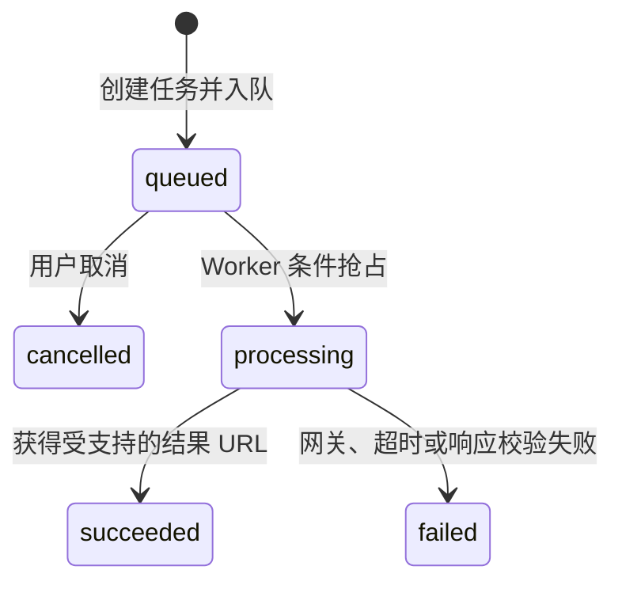

# 音频生成任务开发清单

更新日期：2026-10-27

## 本阶段已完成

- `POST /api/console/audio-generations`：校验登录、工作区权限、工作区已启用模型及音频类型，后端按模型价格计算预估费用。
- `GET /api/console/audio-generations` 与 `GET /:id`：只允许读取当前工作区中当前用户自己的任务，响应仅返回文本预览。
- `POST /:id/cancel`：只取消 BullMQ 尚未开始处理的排队任务；处理中任务不伪装成已取消。
- PostgreSQL `audio_generation_tasks`：保存请求参数、供应商目标、状态、结果、错误、预估/结算费用槽位和生命周期时间。
- BullMQ `audio-generation` Worker：队列只传任务 ID，处理前以条件更新抢占 `queued -> processing`。
- 音频数据面适配器：调用内部 `/audios/generations`，支持直接返回 URL，或返回任务 ID 后轮询；结果 URL 只接受 HTTP(S)。
- Web 音频工作台：真实提交、状态轮询、排队取消、失败原因、试听、下载和本人历史记录。
- 演示数据：数据库迁移为演示工作区接入 `minimax/speech-3`，不在前端硬编码工作区可用性。
- 验证：API/Web 类型检查、PostgreSQL 状态流转与租户/用户隔离测试、登录态 HTTP 提交/查询烟测。

## 已验证状态

本地未配置 `AUDIO_GENERATION_GATEWAY_URL` 或 `PROVIDER_GATEWAY_URL` 时，任务会从 `queued` 进入 `failed`，错误为 `upstream_503 / 音频数据面尚未配置`。这是已验证的显式失败路径，不代表真实供应商已验收。

## 下一阶段清单

| 优先级 | 状态 | 开发项 | 验收条件 |
| --- | --- | --- | --- |
| P0 | 待开发 | 计费预占、结算与失败释放 | 创建前校验额度；成功按实际量结算；失败/取消原子释放；重复消息不重复扣费 |
| P0 | 待开发 | 平台对象存储 | 上游产物进入受控 Bucket；下载使用短时签名 URL；到期清理可重试并可审计 |
| P0 | 待开发 | 幂等与恢复 | 支持 `Idempotency-Key`；Worker 崩溃后扫描恢复；重复消费保持单一任务和单次结算 |
| P0 | 待开发 | 重试与失败队列 | 仅瞬时错误有限重试；永久错误直接失败；耗尽后进入 DLQ 并支持管理端重放 |
| P1 | 待开发 | 真实供应商验收 | 至少一个 TTS 供应商完成请求、异步轮询、音频试听、超时和错误映射测试 |
| P1 | 待开发 | 上游取消 | 对支持取消的供应商中断处理中任务；不支持时明确拒绝并展示原因 |
| P1 | 待开发 | 公共 API | 完成计费与幂等后开放 API Key 鉴权的 `/v1/audios/generations` |
| P1 | 待开发 | 能力与音色配置 | Admin 配置模型参数范围、默认值、音色列表与语言，Web 按能力动态渲染 |
| P1 | 进行中 | 可观测性 | 音频队列 waiting/active/delayed/failed 积压指标与阈值告警已完成；任务等待/处理时长、成功率、供应商错误细分和 DLQ 指标待开发 |
