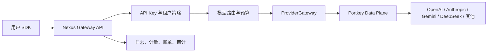

# 多模型供应商网关选型

## 2026-10-24 实施状态

第一阶段先交付内部 `ProviderGateway` 的 OpenAI 兼容直连 Adapter，以便后台已有 Provider、Credential、Channel、Deployment 配置立即进入真实执行链。直连受精确域名白名单、HTTPS、禁止重定向、环境隔离和按渠道凭证约束，未配置部署时仍可走 `PROVIDER_GATEWAY_URL` 内部网关。Portkey 保留为第二个 Adapter 选项，不再阻塞 DeepSeek 等 OpenAI 兼容供应商的首个真实验收。详见 [供应商数据面第一阶段开发清单](provider-data-plane-development-checklist.md)。

更新日期：2026-10-22

## 结论

Nexus 不应为每个供应商分别维护一套调用协议。推荐把供应商差异放进独立的数据面，并由 Nexus 自己保留租户、计费、产品权限、路由配置和审计控制面。

第一候选是 [Portkey 开源 AI Gateway](https://github.com/Portkey-AI/gateway)。它采用 MIT 许可证、TypeScript 技术栈，支持 OpenAI 兼容入口、流式调用、重试、故障转移和负载均衡；其官方模型目录当前列出 72 个供应商和 3,701 个模型，并覆盖文本、图像、音频、批处理和微调等端点。[官方供应商目录](https://portkey.ai/models/providers)

接入时不让业务模块直接依赖 Portkey SDK。API 内部先定义稳定的 `ProviderGateway` 接口，再提供 `PortkeyProviderAdapter`。以后切换到自研适配器、云厂商原生网关或其他开源方案时，模型路由、计费和控制台无需重写。

## 方案对比

| 方案 | 定位 | 优点 | 主要限制 | 本项目建议 |
| --- | --- | --- | --- | --- |
| Portkey Gateway | 自托管 AI 数据面 | TypeScript、MIT、OpenAI 兼容、路由/重试/回退/观测能力完整 | 部分企业治理能力属于商业版；需要验证国内供应商细节 | 作为首选 PoC，固定版本并放在内部网络 |
| LiteLLM Proxy | Python 多供应商代理 | 供应商覆盖广、OpenAI 兼容、生态成熟 | 引入 Python 运行栈；官方安全公告中已有 SSRF 和供应商凭证泄露类问题，需要严格版本与隔离策略 | 暂不作为默认数据面，保留替代适配器可能性；参考其[官方安全公告](https://github.com/BerriAI/litellm/security/advisories) |
| Vercel AI SDK | TypeScript 应用 SDK | `generateText`、`streamText`、结构化输出和工具调用开发体验好 | 它是应用 SDK，不是完整的多租户网关控制面 | 可用于特定 Agent/应用服务，不承担 Nexus 核心数据面；参考[官方仓库](https://github.com/vercel/ai) |
| 全自研供应商适配 | 内部代码 | 完全可控、可按业务裁剪 | 持续追踪协议、流式格式、错误码和新模型的成本高 | 只为缺失或差异较大的供应商补充适配器 |

## 目标接口边界

```ts
interface ProviderGateway {
  chat(input: ChatRequest, context: ProviderContext): Promise<ChatResponse>
  streamChat(input: ChatRequest, context: ProviderContext): AsyncIterable<ChatChunk>
  embeddings(input: EmbeddingRequest, context: ProviderContext): Promise<EmbeddingResponse>
  generateImage(input: ImageRequest, context: ProviderContext): Promise<ImageResponse>
  health(target: ProviderTarget): Promise<ProviderHealth>
}
```

`ProviderContext` 只携带内部解析完成的工作区、项目、目标模型、路由尝试编号、预算和追踪 ID。供应商密钥由适配器从加密凭证仓读取，不允许出现在请求 DTO、普通日志或前端响应中。

## 部署边界



- Portkey 只负责协议转换和供应商调用，不接管 Nexus 用户、工作区、套餐和账单模型。
- 容器镜像必须固定到摘要，不使用 `latest`；上线前执行依赖和镜像扫描。
- 数据面不暴露公网管理入口，只允许 Nexus API 通过内部网络访问。
- 供应商密钥使用独立密钥管理服务加密，数据面仅在调用时获得最小权限凭证。
- 首批 PoC 同时覆盖同步、SSE、工具调用、超时、429、5xx、取消和故障转移场景。

